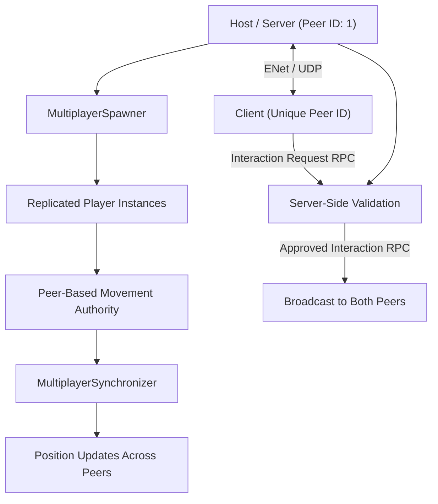

# Eagle Eye | Multiplayer Networking Showcase
A standalone Godot 4 networking demonstration based on the multiplayer architecture developed for Eagle Eye, a multiplayer FPS project. Featuring ENet, host-client networking, player authority, synchronized movement, and server-approved interactions using Remote Procedure Calls (RPCs).


## Features
* ENet Networking: Host and join multiplayer sessions using Godot's ENet implementation over UDP.
* Connection Management: Handle peer connections, disconnections, connection failures, and duplicate connection attempts.
* Dynamic Player Spawning: Automatically replicate player creation and removal using MultiplayerSpawner.
* Multiplayer Authority: Assign ownership using unique peer IDs so each player controls their own character.
* Movement Synchronization: Replicate player positions using MultiplayerSynchronizer.
* Player-Specific Cameras: Activate the camera belonging to the locally controlled player.
* Remote Procedure Calls (RPCs): Send interaction requests to the server, validate the sender's participation, and broadcast approved interactions.
* Two-Player Support: Demonstrate multiplayer communication between a host and one client.

## Network Architecture
The project uses Godot 4's high-level multiplayer API over ENet, with one instance acting as the host/server and another as the client.



## Authority Model
The project uses a hybrid approach to multiplayer authority:
* Player movement: Each peer controls its own character. Position updates are replicated to the other peer using MultiplayerSynchronizer.
* Player spawning: The host/server creates and removes player instances. MultiplayerSpawner replicates these changes.
* Interactions: Clients send requests through RPCs. The server verifies that the requesting peer has an active player before broadcasting an approved interaction.
* This demonstrates the distinction between client-authoritative movement, server-managed player lifecycle, and server-approved actions.
* The project is intended as a networking demonstration, not a production-ready anti-cheat or server-authoritative movement implementation.

  
## Getting Started

### Requirements

- Godot Engine 4.x
- Git (for cloning the repository)
- Two running game instances for local multiplayer testing

### Installation

Clone the repository:

```bash
git clone https://github.com/michael03433/eagle-eye-networking.git
```

Open Godot, select **Import**, and navigate to the cloned repository's `project.godot` file.

Once imported, open the main networking scene if it is not already configured as the startup scene.

### Running the Demo

1. Open the project in Godot.
2. Navigate to **Debug → Customize Run Instances**.
3. Enable multiple instances and set the instance count to **2**.
4. Run the project by selecting the play button at the top right of the screen.
5. Press **H** in the first instance to host.
6. Press **J** in the second instance to join.
7. Use **WASD** to move each player.
8. Press **F** to test server-approved interactions.

### Controls

| Key | Action |
|-----|--------|
| H | Host a multiplayer session |
| J | Join a local multiplayer session |
| W | Move forward |
| A | Move left |
| S | Move backward |
| D | Move right |
| F | Request a server-approved interaction |

### Network Configuration

- **Transport:** ENet over UDP
- **Port:** `9999`
- **Default Address:** `127.0.0.1` (localhost)
- **Maximum Players:** 2 (one host and one client)

The default configuration is intended for local multiplayer testing.

To connect across different machines, update the server address in `network_manager.gd` and ensure that UDP traffic on port `9999` is permitted.

### Expected Behavior

Once connected:

- Both instances contain two player nodes with matching peer IDs.
- Each player controls their own character.
- Player positions synchronize across both instances.
- Interaction requests are validated by the server and broadcast to both peers.
- Disconnecting a client removes their player from the session.
